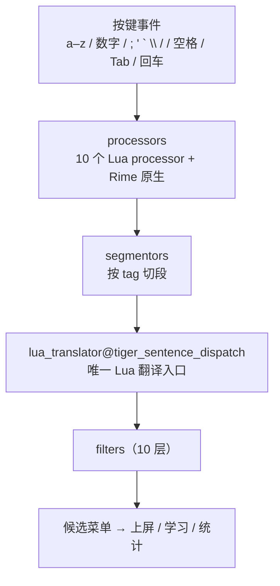
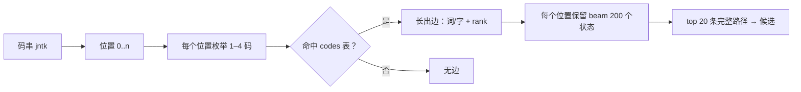

# 虎整句运行原理

> 面向维护者的架构说明（对应 v0.3.27）。代码位置以仓库路径为准，
> 关键实现集中在 `lua/tiger_sentence.lua`（约 5000 行）与 `tiger_sentence.schema.yaml`。

## 0. 一句话

虎单 / 虎词是 Rime 的 `table_translator` 查词典；虎整句是把**整套整句解码引擎用 Lua 重写**：
词库是纯文本码表，候选由五阶语言模型在输入时现场算出，Rime 只负责按键、分段与渲染。

## 1. 与虎单 / 虎词的区别

| 维度 | 虎单 / 虎词 | 虎整句 |
|---|---|---|
| 翻译器 | `table_translator`（Librime 原生） | `lua_translator@tiger_sentence_dispatch` |
| 词库 | Rime 词典（`.dict.yaml`，需部署编译） | `tiger_sentence.codes.txt` 纯文本，运行时加载 |
| 候选来源 | 词典命中 | lattice 路径 + 五阶模型打分 |
| 长句 | 逐词上屏 | 整句一次解码 |
| 改码表 | 改 dict → 重新部署 | 改 txt → 重新载入即可 |

## 2. 整体流水线



### 2.1 按键层（processors）

顺序（`tiger_sentence.schema.yaml`）：

```
input_statistics_proc → set_schema → tiger_zaoci_processor → key_counter
→ shift_upper → yin_full → tiger_sentence_ascii → recognizer
→ reverse_freq → tiger_kf → tiger_sentence_processor → key_binder
→ speller → punctuator → selector → navigator → express_editor
```

两个容易踩的点：

- **整句处理器排在 `key_binder` 之前**：Tab 先由 Lua 的 `cycle_candidate_highlight`
  移动高亮并置位 `tab_pending`（学习/调频基线），`key_binder` 的 Tab→Down 只在该段
  无可用菜单时兜底。
- **`tiger_sentence_ascii` 必须存在**：保证「提前上屏至编码」的 buffered 状态下
  按 Shift 切西文时提交显示候选，而不是提交内部 `~` 标记。

### 2.2 分段层（segmentors）

段只负责“贴标签”，不产出候选：

| 前缀 / 形态 | tag | 归属 |
|---|---|---|
| `` ` `` + 字母 | `yin_flypy` / `yin_qp` / `yin_zrm` / `yin_mspy` / `yin_sogou` | 拼音反查（`yin_pick` 按打法换 tag） |
| `'` + 编码 | `zaoci` | 造词 |
| `\` + 编码 | `yin_full` | 全字集反查（`table_translator@yin_full`） |
| 标点 | `punct` | `punct_translator` |
| 其余 | （无） | 整句主引擎 |

主引擎在 `translator()` 开头检查这些 tag，命中即 `return`，避免把
`'nihao` 当虎码解出「玉𦀀」这类脏候选。

### 2.3 翻译层

`schema` 里只有一个 Lua 翻译入口：

```yaml
translators:
  - punct_translator
  - lua_translator@tiger_sentence_dispatch
  - table_translator@zaoci
  - table_translator@yin_full
```

`tiger_sentence_dispatch.lua` 内部按序调用：

```
mixed → pinyin → zaoci → 主引擎(sentence) → number → calculator → shijian2 → statistics
```

每个生产者只对自己负责的输入 `yield`，所以合并入口不会混候选。
**这是性能设计**：librime-lua 每销毁一个 `LuaTranslation` 会跑一次全量 GC，
把 7 个入口合并成 1 个后，隔离实测从 64.2 降到 25.3 ms/键。

## 3. 数据层

| 文件 | 规模 | 作用 |
|---|---|---|
| `tiger_sentence.codes.txt` | 15,369 条词条 | `<词>\t<码>`；**同一码下的行序 = 词条名次**（rank 1 起） |
| `tiger_sentence.char_ranks.txt` | 20,000 字 | 字频秩；用于常用字最优码限制与生僻字隔离惩罚 |
| `tiger_sentence.common_characters.txt` | — | 常用字集（`Ctrl+J` 切换） |
| `tiger_sentence.supplement.txt` + 自造词 | — | 用户补充词，解码时并入 lattice |
| `models/sentence-fivegram-mobile.bin` | 405,663,171 B | TCSKNM03、五阶、Q8；**分页读**，非一次性载入 |

要点：

- 码长实际为 **1–4 码**；`codes` 表按码串索引，一个码可对应多个词条（重码）。
- 词库不进 Rime 词典系统，所以改码表不需要部署编译；代价是首次输入要装载模型。
- `char_ranks` 删除后，两处启发式（最优码、隔离惩罚）自动失效。

## 4. 解码核心（`decode()`）

### 4.1 建格



- 输入先归一化：转小写、剥离尾部的数字 / `;` / `'` 选重键；原始上限 128 键。
- 边 = 一次词条命中，带 `raw_length`、`text`、`rank`。
- 状态 = `已选文本 + 前两个字 + 累计分数 + KN 的 4 阶历史缓存 + 各类先验`。

### 4.2 剪枝（beam）

| 条件 | beam 宽度 |
|---|---|
| 输入 ≤ 24 键 | 200 |
| 输入 > 24 键 | 48 |

同一位置按累计分数保留最优状态，其余丢弃；`dedup_limit` 还会按文本去重，
避免同文本不同切分挤占 beam。

### 4.3 打分

```
score(path) = Σ log P₅(cᵢ | cᵢ₋₄ … cᵢ₋₁)   -- 五阶 Kneser-Ney，Q8 反量化
            + 2.0 × 字数                      -- emitted_character_reward，抑制碎字
            + log P(EOS | 句尾)

排序分 = score + 规范码加成(code_score) + 词先验
              + 补充词奖励 + 自造词奖励
              − 生僻字隔离惩罚(isolation_penalty)
```

- 五阶模型是**字符级**的：预测的是“下一个汉字”，不是“下一个词”。
- `high_freq_limit`（默认 1500）只允许前 1500 高频字使用最优码参与组句，
  其余字放宽非最优码——这是“常用字出简”的实现方式。

### 4.4 排序与置信度分离

这是提前上屏不“乱跳”的关键：

- **排序分**可以包含规范码、词先验、补充词等启发式；
- **置信度** `confidence_score` 只用文本项（KN + EOS − 纯文本隔离惩罚），
  启发式不得参与。

否则调频或词先验一加权，就可能把某条候选“刷”成高置信度而被自动上屏。

### 4.5 增量解码

- 已确认前缀通过 **lock**（`RawPrefix`：raw / text / boundaries）记住，后续解码不跨锁。
- 追加按键：复用已有 `states`，只对新位置 `expand_range`。
- 回删：只截断尾部状态，不清空整句。

## 5. 三条输入路径

| 路径 | 触发 | 码表 | 是否学习 / 提前上屏 |
|---|---|---|---|
| 纯虎码 | 直接打字母 | `tiger_sentence.codes.txt` | 是 |
| 拼音反查 | `` ` `` 前缀 | `pinyin.qp.codes.txt`（247,765 行） | 否（只做短输入调频） |
| 混输 | 句中含 `` ` `` 块 | 虎码表 + 拼音词条 | 是（整句照常） |

### 5.1 拼音反查：第二实例

- `lua/tiger_sentence_pinyin.lua` 用 `dofile` 再加载一份 `tiger_sentence.lua`，
  得到**词库 / beam / 解码缓存完全独立**的第二实例（`lexicon_state` 绑定单码表，不能共表）。
- 码表是 `pinyin.qp.codes.txt`（全拼音节 + 辅助码 + 简拼 + 词），
  虎码专用的 `char_ranks` / `whitelist` / `supplement` 全部跳过。
- 键位：
  - 小鹤 / 自然码：`models/pinyin.flypy.*`、`models/pinyin.zrm.*` **专用码表**，
    键串 → 全拼码精确匹配，查不到就是没候选，不做键位转换兜底；
  - 微软 / 搜狗：走 `lua/pinyin_keymaps.lua` 的键位转换。
- 反查候选不走提前上屏与学习（`learning_index = nil`）。
- 短输入调频：≤ 8 字母的反查，选中过非首选就置顶，记录在 `reverse_freq.txt`
  （`lua/reverse_freq.lua`）。

### 5.2 混输：overlay

输入形如 `je`jiyu`beuegm`：

1. `tiger_mixed.build_overlay()` 扫描整段：段首与每个 `` ` `` 之后优先按拼音解析，
   解析出词条的块作为一个“词 token”。
2. 把该块替换成一个**不会与真实虎码冲突的临时 3 字母码**（避开真实码前缀，
   防止被拆成 1+2 或 2+1 抢候选）。
3. 调用 `tiger_sentence.decode_with_overlay` 与前后虎码一起解码。
4. 结束后还原码表，候选文本与普通整句无异。

闸门：解析不出任何拼音词 → 返回 nil（纯反查）；虎码在前的混输段仍要求有虎码字面量；
双拼打法下拼音块只收整音节词条（不收简拼）。

## 6. 交互与状态

| 行为 | 实现 |
|---|---|
| 空格提交 | 提交当前高亮；`commitBranchOrCandidate` 统一走 `noteCommit` |
| Tab / ↑↓ | Lua 先移动高亮并置 `tab_pending`；Tab 确认会生成学习事件 |
| 数字 / `;` / `'` 选重 | `parse_selector` 解析尾部选重键 |
| 提前上屏 | 输入 > 4 键才开始积累证据；证据池首选份额足够 + 最短保留（概率型至少 3 码）→ 提交前缀并加锁 |
| 空码顶屏 | 唯一强候选时自动提交（`capture_empty_code_candidate`） |
| 回删 | 三档：回删编码 / 回删整字 / 先编码后整字（`tiger_sentence_backspace.lua`） |
| 回车 | `EnterClear` 开 = 清屏；关 = 输出尚未上屏的剩余原码 |
| 学习 | Tab 确认、直接点选都生成学习事件（`tiger_sentence_learning.lua`） |
| 造词 | `'` 或 `` ` `` 编码造词 → 用户词库 → `zaoci_bridge` 并回 lattice |

提前上屏有「上屏到应用」和「上屏到编码」两种模式
（`tiger_sentence_early_commit_to_preedit`）；后者把已确认前缀放进预编辑缓冲区，
不直接写应用。

## 7. 滤镜链（按 schema 顺序）

```
buffer_filter → simplifier@pinyin → db → chaifen → simplifier@emoji_cn
→ charset_comment_filter → lua_unicode_display_filter → charset_filter
→ super_replacer → uniquifier
```

| 滤镜 | 作用 |
|---|---|
| `buffer_filter` | 暂存候选（提前上屏至编码） |
| `pinyin` | 拼音显示（simplifier） |
| `db` | 重码替换、反查 ` 后缀处理 |
| `chaifen` | 〔拆分·虎码〕注释（`tiger_lookup` 反查表） |
| `emoji_cn` | emoji 候选 |
| `charset_comment_filter` | Unicode 字符集提示 |
| `unicode_display` | U 区字符显示 |
| `charset_filter` | 字符集联动（繁体字集开放） |
| `super_replacer` | 简繁四档（s2s / s2t / s2hk / s2tw） |
| `uniquifier` | 最终去重 |

## 8. 性能设计

- **Lua 翻译入口 7 → 1**：避免每个 `LuaTranslation` 析构触发全量 GC。
- **模型分页 IO**：`TCSKNM03` 索引按页换入，`logp` 有 LRU，解码有缓存。
- **内存档**：`compact`（默认，省内存）/ `balanced`（大缓存，桌面可选）。
- **硬上限**：输入 128 键、beam 200/48、候选 20 条、反查键串 120。
- **惰性加载**：主引擎与造词模块在首次真正用到时才 `require`，测试环境没有
  `rime_api` 也能跑。

## 9. 关键文件索引

| 路径 | 内容 |
|---|---|
| `tiger_sentence.schema.yaml` | 方案定义：processors / segmentors / translators / filters / 配置键 |
| `lua/tiger_sentence.lua` | 主引擎：词库加载、lattice、beam、KN 打分、提前上屏、学习对接 |
| `lua/tiger_sentence_fivegram.lua` | TCSKNM03 Q8 五阶模型的分页读取 |
| `lua/tiger_sentence_learning.lua` | 学习事件与学习库 |
| `lua/tiger_sentence_backspace.lua` | 三档回删 |
| `lua/tiger_sentence_dispatch.lua` | 唯一 Lua 翻译入口的组合 |
| `lua/tiger_sentence_pinyin.lua` | 拼音反查（第二实例 + 键位 + 专用表） |
| `lua/tiger_mixed.lua` | 虎码 + 拼音混输的 overlay |
| `lua/tiger_pinyin_map.lua` | 双拼键串 → 全拼码精确查表 |
| `lua/reverse_freq.lua` | 短输入反查调频 |
| `lua/chaifen.lua` | 拆字注释滤镜 |
| `lua/zaoci*` | 造词与 `zaoci_bridge` |

## 10. 修改时的硬约束

1. `lua/tiger_sentence.lua` 主 chunk 的局部变量已到 Lua 上限（199/200）。
   **不要新增顶层 `local`（包括 `local function`）**，新逻辑内联进已有函数或挂全局表。
2. 双实例共享同一份主 chunk：改 `read_data_file` / `rebuild_lexicon` / `M.translator`
   时必须同时验证虎码与拼音两条路径。
3. 置信度口径不能引入排序启发式，否则提前上屏会被“刷”出来。
4. 主引擎靠 tag 跳过别的段；改 recognizer / affix 前缀时三个 schema 要同步。
5. 改动后必跑：契约测试（21 cases / 132 checks）+ `tools/run_regressions.py`。
